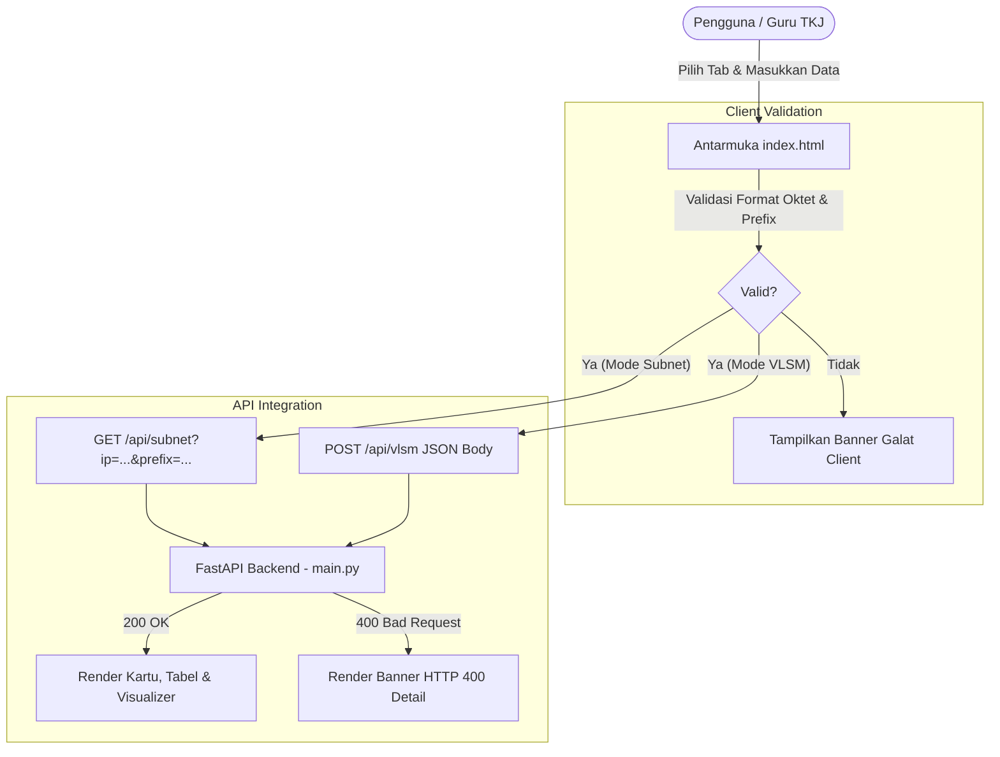

# Desain Antarmuka & Arsitektur UI: Kalkulator Subnet & VLSM IPv4

Dokumen ini menjelaskan arsitektur antarmuka pengguna (*User Interface* / UI) dan pengalaman pengguna (*User Experience* / UX) untuk aplikasi web **Kalkulator Subnet & VLSM IPv4**, melengkapi spesifikasi teknis pada [SPEC.md](SPEC.md).

---

## 1. Filosofi & Pendekatan Desain

Antarmuka dirancang khusus sebagai alat peraga edukatif (*Educational & Teacher-Friendly Tool*) bagi pengajar, siswa, dan praktisi jaringan komputer (SMK TKJ dan Mahasiswa Informatika). Prinsip desain berfokus pada:
- **Clean & Focused (Google Clean Style)**: Palet warna bersih dengan kontras terukur (`#1a73e8` Google Blue, `#1e8e3e` Green, `#d93025` Red, `#f9ab00` Amber).
- **Single Page Application (SPA)**: Berkas tunggal `index.html` yang ringan, cepat dimuat, tanpa framework eksternal berat (*zero-dependency frontend*).
- **Feedback Interaktif & Eksplisit**: Respon validasi dan penanganan galat (*error handling*) ditampilkan mencolok dengan visualisasi bitwise yang mudah dipahami.

---

## 2. Tipografi & Skema Warna

### Tipografi
- **Prose & Label**: `'Plus Jakarta Sans'`, `'Google Sans'`, sistem sans-serif modern.
- **Nilai Teknis (IP, Subnet Mask, Biner, CIDR)**: `'JetBrains Mono'`, monospace dengan keterbacaan tinggi.

### Skema Warna UI
| Token Warna | Nilai Hex | Penggunaan |
| :--- | :--- | :--- |
| `--bg-page` | `#f8f9fa` | Latar belakang halaman |
| `--bg-surface` | `#ffffff` | Kartu konten dan panel |
| `--border-default`| `#dadce0` | Garis pembatas komponen |
| `--google-blue` | `#1a73e8` | Warna aksi utama, tab aktif, bit network |
| `--google-green`| `#1e8e3e` | Status sukses, host valid |
| `--google-red` | `#d93025` | Alert error validasi / HTTP 400 |
| `--google-yellow`| `#f9ab00`| Bit host, broadcast note |

---

## 3. Komponen Antarmuka Utama

### A. Header Aplikasi
- Menampilkan judul aplikasi, lencana *Modul Guru TKJ*, serta deskripsi singkat fungsi alat.

### B. Navigasi Mode Tab
Menyediakan dua tab utama yang mudah dialihkan:
1. **Tab 1: Kalkulator Subnet Standar**
   - Input Alamat IP (validasi 4 oktet tanpa leading zero).
   - Selector Prefix CIDR (Dropdown `/0` s/d `/32`, input numerik, dan slider sinkron).
   - Tombol *Quick Presets* (`/8`, `/16`, `/24`, `/26`, `/28`, `/30`).
2. **Tab 2: Kalkulator VLSM (Variable Length Subnet Mask)**
   - Input Blok Jaringan Induk (contoh: `192.168.1.0/24`).
   - Formulir dinamis daftar kebutuhan host (tambah/hapus baris kebutuhan departemen).
   - Tombol alokasi otomatis berurutan dari kebutuhan terbesar.

### C. Area Hasil & Visualisasi Edukatif
- **Kartu Ringkasan (Summary Cards)**:
  - Network Address (CIDR notation)
  - Broadcast Address (dengan label khusus `None` pada `/31` dan `/32`)
  - Usable Host Range (First IP s/d Last IP)
  - Jumlah Usable Host & Total Alamat
- **Visualisasi Bitmask & Alokasi**:
  - Segmentasi visual bit Network vs bit Host dengan progress bar dinamis.
  - Representasi biner 32-bit dengan penandaan warna kontras tiap oktet.
- **Tabel Alokasi VLSM**:
  - Menampilkan urutan alokasi, nama segmen/departemen, kebutuhan host, prefix subnet yang dialokasikan, network address, broadcast address, dan sisa kapasitas.

### D. Penanganan Galat (Error Banner)
- Banner peringatan merah mencolok (`--google-red-bg` dan border `--google-red`) yang muncul otomatis saat API mengembalikan status HTTP 400 atau validasi client gagal.
- Menampilkan pesan error eksplisit (contoh: *"Leading zeros are not allowed: 192.168.01.1"*, *"Total kebutuhan host melebihi kapasitas subnet induk"*).

---

## 4. Alur Integrasi API (Client-Server)

---

## 5. Responsivitas & Aksesibilitas
- **Mobile First / Responsive Grid**: Berfungsi optimal pada perangkat seluler, tablet, hingga layar desktop proyektor kelas.
- **Aksesibilitas Keyboard**: Mendukung navigasi Tab, tombol Enter untuk kalkulasi, serta peran ARIA (`role="tab"`, `aria-selected`).
- **Fungsi Salin (Copy-to-Clipboard)**: Tombol salin ringkas satu klik untuk mempermudah transfer hasil ke modul praktikum atau laporan lab.
